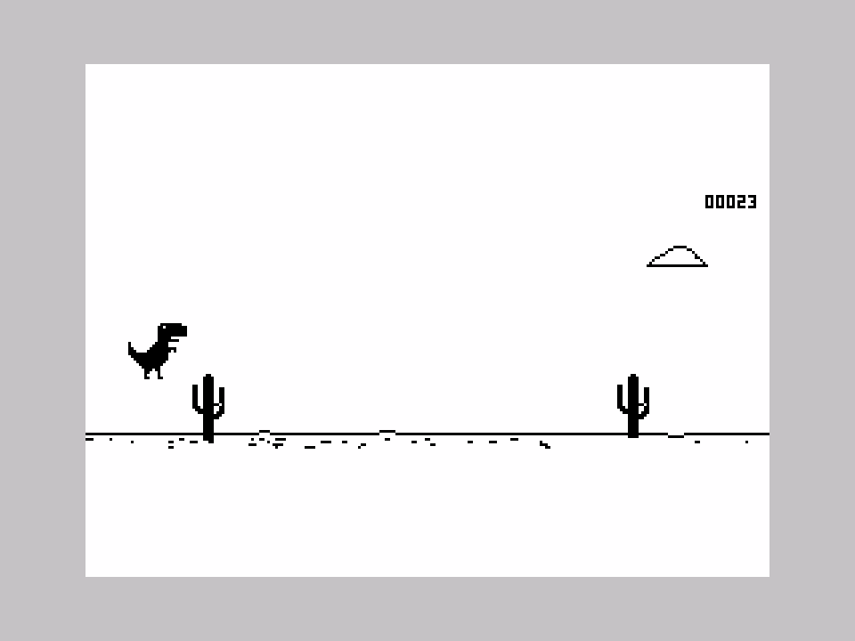
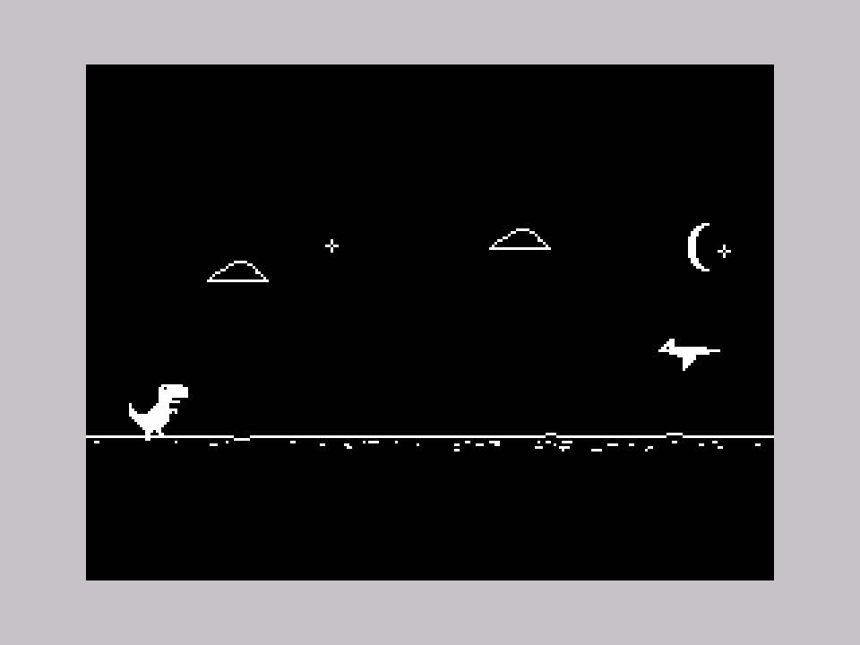

# ZX-Dino: Dino Run for OpticOS

Dino Run is a remake of the Chrome offline T-Rex runner for the 48K ZX Spectrum running **[OpticOS](https://github.com/brixham99/OpticOS)**. It is written in **OpticBASIC**, with a small **machine code core** for the parts BASIC is too slow for.

(c) 2026 Optica Technology Design.

| | |
|---|---|
|  |  |
|  |  |

> **It needs the OpticOS ROM.** The game uses OpticBASIC: named PROCs, `KEY()`, `DPOKE`, `WAIT` and `SAVE … AUTO`. It will not run on the Sinclair 48K ROM. Build or download `opticos.rom` from <https://github.com/brixham99/OpticOS>.

## Controls

| Key | Action |
|---|---|
| SPACE, Q or 7 (cursor up) | Jump (hold for a higher jump) |
| A or 6 (cursor down) | Duck, or fall faster in the air |
| SPACE | Start, or restart after GAME OVER |
| BREAK (CAPS SHIFT + SPACE) | Stop |

The game speeds up as the score rises. Pterodactyls join in from a score of about 590, at three heights: jump the low ones, duck under the middle ones, and run under the high ones. HI and the score show at the top right, as in Chrome.

## Loading

- **Fuse:** start a 48K machine with the OpticOS ROM, for example `fuse --machine 48 --rom-48 opticos.rom`. Open `dino.tzx` or `dino.tap`, then type `LOAD ""` and press ENTER. With tape traps off, start the tape (F8). The program runs itself, then loads its code block.
- **The Spectrum** (running OpticOS): copy `dino.tzx` to the USB stick, choose it with **M** in Media select, then `LOAD ""`.

The tape holds two blocks: the program `dinorun` (`SAVE "dinorun" AUTO start`) and `dinocode` (`CODE 48000,4408`).

## How it is split

| Part | Size | What it does |
|---|---|---|
| `dino.bas`, OpticBASIC | 4,220-byte program block (140 lines) | Title screen, game loop, choosing each obstacle (type, group size, gap, bird height, never three of a kind in a row), speed ramp, beeps, HI score, GAME OVER and restart |
| `dino.asm`, Z80 | 4,408-byte code block at 48000 | IM 2 frame-interrupt engine at 25 steps a second (it also calls the ROM's own `$0038`); jump physics (8.8 fixed point, Chrome-style variable jump height); collision against eroded masks; scrolling ground (8 pre-shifted copies); pre-shifted sprites built in RAM at start-up; an off-screen buffer copied to the screen by dirty spans, ahead of the beam, so nothing tears; clouds; score digits drawn in OpticOS's own 4x8 font |

BASIC drives the code through `CALL`, `USR`, `POKE` and `PEEK`. Because the code runs from the interrupt, BASIC can take its time choosing the next obstacle: the code asks for it early. The interface is described at the top of `dino.bas`.

## Building

Building needs Python 3 with Pillow, [pasmo](https://pasmo.speccy.org/), and a built checkout of OpticOS (for its ROM, font and Z80 test rig):

```
export OPTICOS=/path/to/OpticOS      # built: build/opticos.rom and the rig's libz80.so
python3 build.py                     # sprites.py -> sprites.inc, pasmo -> dinocode.bin,
                                     # then dino.tap / dino.tzx recorded through the ROM's own SAVE
python3 tools/rigtest.py             # headless test: a bot plays (about 2,700 points), crash, restart
```

`tools/fuse_play.py` plays the game in real Fuse, slowed down, using a pilot that reads the screen's pixels. It needs the Fuse helpers from the Happy Bat tools (set `HAPPYBAT_TOOLS`), Xvfb and xdotool.

## Known issues

- On the GAME OVER screen a very short tap (under about 3 frames) can be missed, and keys are ignored for the first 0.6 s.
- The title screen shows the score as `00000` (Chrome shows nothing there).
- The GAME OVER text can wipe part of a cloud.
- The score digits can tear for a single frame now and then.
- No night mode, no score flash, and the sound is simple beeps (BEEP blocks interrupts, so they are kept very short).

## Credits and licence

The graphics are a **fan recreation** of the dinosaur game in Google Chrome, redrawn by hand at Spectrum resolution. This project is **not affiliated with or endorsed by Google**, and the original T-Rex, cactus and pterodactyl designs belong to Google.

The game contains no Sinclair, Amstrad or other third-party ROM code, and no ROM is included. Licensing follows OpticOS; see [LICENSE](LICENSE).
