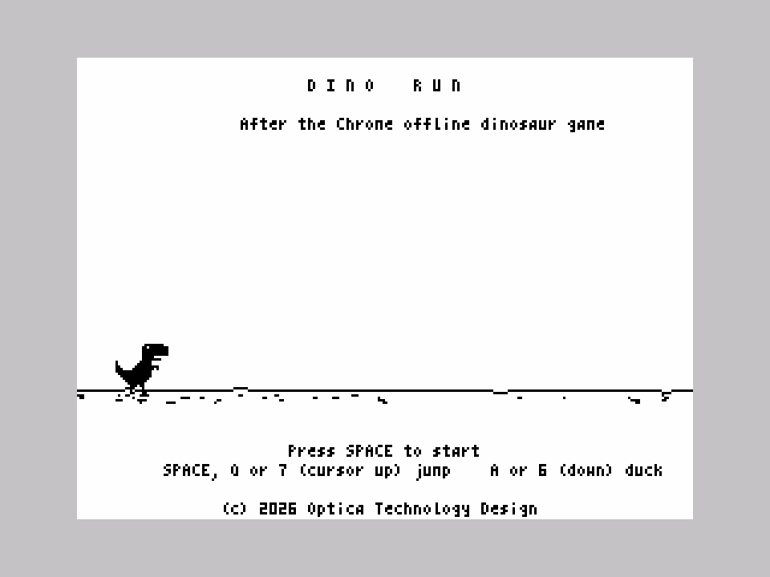
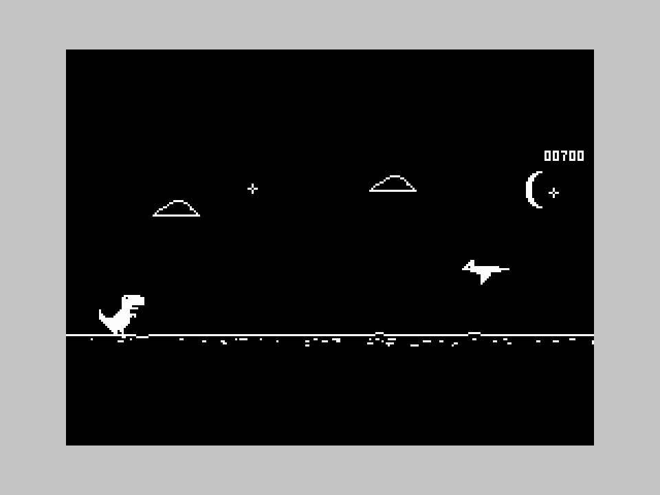
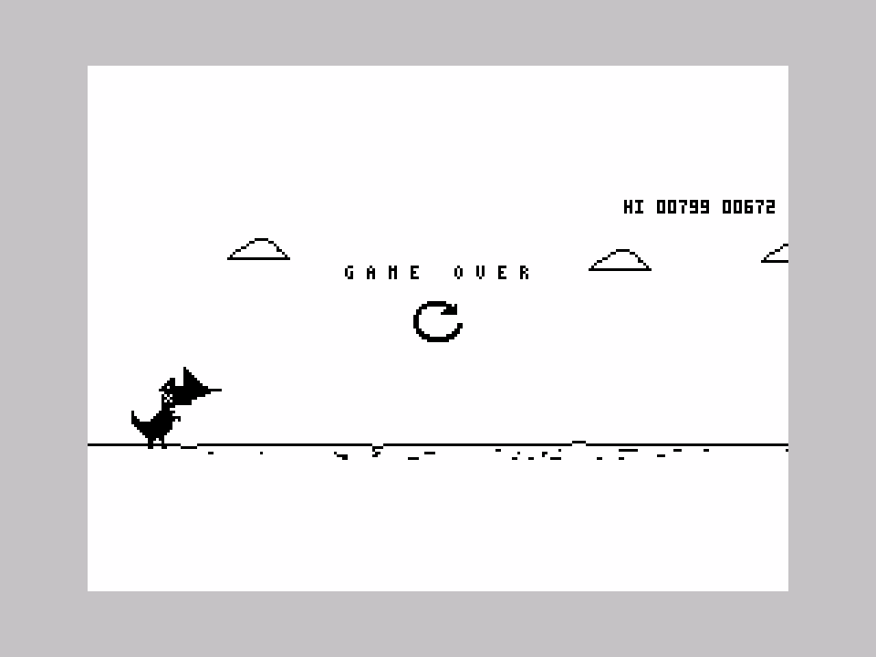
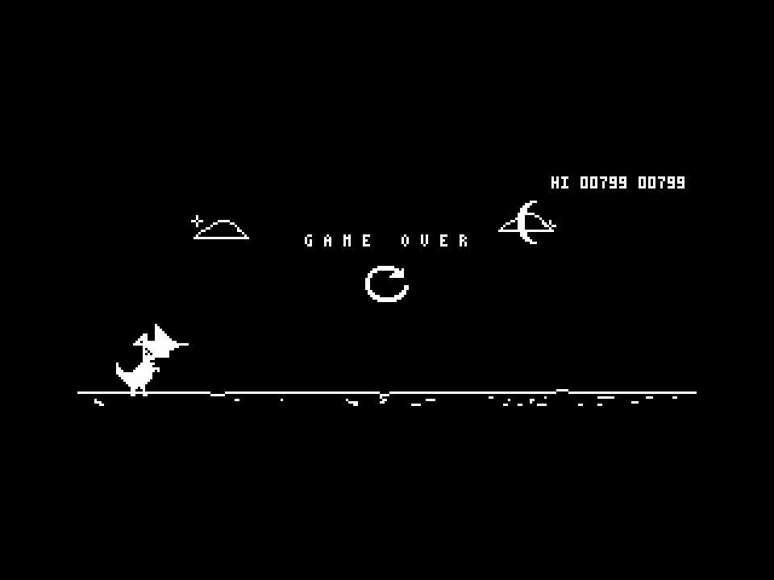

# ZX-Dino: Dino Run for OpticOS

Dino Run is a remake of the Chrome offline T-Rex runner for the 48K ZX Spectrum running **[OpticOS](https://github.com/brixham99/OpticOS)**. It is written in **OpticBASIC**, with a small **machine code core** for the parts BASIC is too slow for.

(c) 2026 Optica Technology Design.

| | |
|---|---|
|  |  |
|  |  |
|  |  |

All six are real Fuse grabs, played by the pixel-reading pilot at 20% speed.

> **It needs the OpticOS ROM.** The game uses OpticBASIC: named PROCs, `KEY()`, `DPOKE`, `WAIT` and `SAVE … AUTO`. It will not run on the Sinclair 48K ROM. Build or download `opticos.rom` from <https://github.com/brixham99/OpticOS>.

## Controls

| Key | Action |
|---|---|
| SPACE, Q or 7 (cursor up) | Jump (hold for a higher jump) |
| A or 6 (cursor down) | Duck, or fall faster in the air |
| SPACE | Start, or restart after GAME OVER |
| BREAK (CAPS SHIFT + SPACE) | Stop |

As in Chrome:
- The game speeds up as the score rises.
- Pterodactyls join in from about 590 points, at three heights: jump the low ones, duck under the middle ones, and run under the high ones.
- The score blinks three times at every 100 points, with the achievement beep.
- At 700 points night falls: the colours fade to white on black and the moon (a new phase each night) and two stars come out. After 12 seconds day returns, and night comes again at every further 700.
- HI and the score show at the top right. The title screen shows no score.
- After a crash, keys are ignored for 0.75 s; after that any tap restarts, however short.

## Loading

- **Fuse:** start a 48K machine with the OpticOS ROM, for example `fuse --machine 48 --rom-48 opticos.rom`. Open `dino.tzx` or `dino.tap`, then type `LOAD ""` and press ENTER. With tape traps off, start the tape (F8). The program runs itself, then loads its code block.
- **The Spectrum** (running OpticOS): copy `dino.tzx` to the USB stick, choose it with **M** in Media select, then `LOAD ""`.

The tape holds two blocks: the program `dinorun` (`SAVE "dinorun" AUTO start`) and `dinocode` (`CODE 46900,5555`).

## How it is split

| Part | Size | What it does |
|---|---|---|
| `dino.bas`, OpticBASIC | 4,655-byte program block (about 150 lines) | Title screen, game loop, choosing each obstacle (type, group size, gap, bird height, never three of a kind in a row), the sounds (jump, 100 points, hit), the border at night, HI score, game over and restart |
| `dino.asm`, Z80 | 5,555-byte code block at 46900: a 1,070-byte phase 2 part (46900–47969), then the entry points and engine at 48000 | IM 2 frame-interrupt engine at 25 steps a second (it also calls the ROM's own `$0038`); jump physics (8.8 fixed point, Chrome-style variable jump height); collision against eroded masks; scrolling ground (8 pre-shifted copies); pre-shifted sprites built in RAM at start-up; an off-screen buffer copied to the screen by dirty spans, ahead of the beam, so nothing tears; clouds. Phase 2 adds: the speed ramp table, the score drawn at the start of each step (before the beam reaches it) and its 100-point blink, night (attribute fade, moon phases, stars), GAME OVER drawn over the scene, and the restart key wait |

BASIC drives the code through `CALL`, `USR`, `POKE` and `PEEK`. Because the code runs from the interrupt, BASIC can take its time choosing the next obstacle: the code asks for it early. The interface is described at the top of `dino.bas`.

## Building

Building needs Python 3 with Pillow, [pasmo](https://pasmo.speccy.org/), and a built checkout of OpticOS (for its ROM, font and Z80 test rig):

```
export OPTICOS=/path/to/OpticOS      # built: build/opticos.rom and the rig's libz80.so
python3 build.py                     # sprites.py -> sprites.inc, pasmo -> dinocode.bin,
                                     # then dino.tap / dino.tzx recorded through the ROM's own SAVE
python3 tools/rigtest.py             # headless test: a bot plays (about 1,500 points, through a night), crash, restart
```

`tools/fuse_play.py` plays the game in real Fuse, slowed down (to 20% by default). The pilot (`tools/pilot.py`) reads only the screen's pixels, by day or by night, and presses keys with xdotool. It needs the Fuse helpers from the Happy Bat tools (set `HAPPYBAT_TOOLS`), Xvfb and xdotool.

## Known issues

- The sounds are short BEEPs. BEEP stops interrupts while it plays, so the 100-point beep (50 ms) pauses play for about 2 frames.
- The border turns black only once the fade to night has finished, and back to white once day has fully returned.
- The colours fade in 4 steps (attributes), not smoothly as in Chrome.
- The speed rises with the score in steps of 32 points, not with time as in Chrome.

## Credits and licence

The graphics are a **fan recreation** of the dinosaur game in Google Chrome, redrawn by hand at Spectrum resolution. This project is **not affiliated with or endorsed by Google**, and the original T-Rex, cactus and pterodactyl designs belong to Google.

The game contains no Sinclair, Amstrad or other third-party ROM code, and no ROM is included. Licensing follows OpticOS; see [LICENSE](LICENSE).
